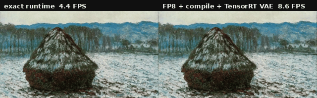

# fastworld

**Interactive video world models on NVIDIA Jetson.**

fastworld runs released autoregressive world models (Matrix-Game-2 first) on a Jetson AGX Thor. It has two tiers:

- **Exact.** The official model is re-run as static-shape CUDA graphs with no host syncs. Its session state can be
  saved, restored and branched, and an exact prefix cache means a player who rewinds never pays for the same chunk
  twice. Output is **bitwise identical** to the official code, on Thor as on a datacenter GPU.
- **Fast.** Approximate drop-ins for the two halves of the model, tuned for Thor's low memory bandwidth: a fused FP8 DiT
  (`FastMG`) and a TensorRT FP16 VAE decoder (`TRTVAE`). They roughly double the frame rate. They plug into the
  same prefix cache.

<p align="center">
  
</p>

*Matrix-Game-2 on a Jetson AGX Thor, same start image and same actions. Left: the exact runtime (4.4 FPS). Right:
FP8 + `torch.compile` DiT with the TensorRT VAE (8.6 FPS). The GIF plays both at the same speed; the FPS labels are
measured. The fast side is not bitwise exact, so after a few chunks it continues into a different, equally plausible
scene: in an autoregressive model small numeric changes compound through the history (see
[docs/jetson.md](docs/jetson.md#fastmg-fastworldmodelsmg2fastpy-fused--fp8-dit)).*

## What you get on Thor

Matrix-Game-2 (1.3B causal DiT, 352x640, 12 frames per chunk), Jetson AGX Thor dev kit in MAXN mode
(`scripts/mg2/thor_e2e.py`, `results/mg2/thor/`):

| | 16-chunk playthrough | rewind workload (6 rewinds) | first new frame after a rewind | output |
|---|---|---|---|---|
| exact runtime: `StaticMG` + Wan VAE | 4.4 FPS | 10.1 FPS | 2.73 s | bitwise = official |
| **`FastMG` (FP8 + compile) + `TRTVAE`** | **8.6 FPS** | **22.2 FPS** | **1.23 s** | approximate |
| `FastMG` + TAEHV tiny decoder | 14.8 FPS | 34.0 FPS | 0.82 s | approximate, lossy decoder |

The rewind workload is served through the exact prefix cache, which takes a checkpoint every 2 chunks. Per component:

| per chunk | exact | fast |
|---|---|---|
| DiT (3 denoising steps + context forward) | 1442 ms (CUDA graphs) | 793 ms (Inductor-fused, FP8 GEMMs), 2.0x |
| VAE decode | 1270 ms (Wan VAE) | 465 ms (TensorRT FP16, 65-67 dB PSNR vs exact), 2.7x |

On Thor the GPU is busy for 98 % of a graph replay, but about half of the DiT's kernel time and three quarters of the
VAE's is bandwidth-bound glue: elementwise ops, layout conversions, fp64 RoPE temporaries and copies. Fusing that glue
(Inductor, TensorRT) and halving GEMM bytes (FP8) is where the speed comes from. The full analysis, including what did
*not* help and a [roofline](docs/jetson.md#roofline), is in [docs/jetson.md](docs/jetson.md). The roofline puts the
fully-fused floor at ~380-480 ms per chunk (25-32 FPS), so the fast runtime is at about a third of what the chip can do.
The largest remaining item is attention: cuDNN's attention runs 2.6x faster than FlashAttention 2 on Thor.

## How it works

### Exact runtime (any NVIDIA GPU)

1. **Static shapes.** These models attend over a bounded window (Matrix-Game-2: exactly one chunk of history), so
   from the second chunk on every tensor has a constant shape. The rolling KV caches, whose indices live on the device
   and are read back with `.item()`, are replaced by fixed per-layer history buffers written in place by the
   context forward. Session state = those buffers.
2. **Static inputs.** Everything that changes per chunk (RoPE tables, noise in the official RNG order, action
   windows, image conditioning) is written into static buffers before replay. Per-step constants (timestep
   embeddings, scheduler sigmas) are computed once with the official ops.
3. **No hidden host traffic.** The official forward builds `cu_seqlens` on the CPU for every flash-attention call,
   runs `torch.arange` on the CPU for the timestep embedding and keeps some RoPE tables on the host. These are
   replaced by device constants and direct `flash_attn_varlen_func` calls.
4. **One graph per chunk.** All denoising steps, the scheduler and the context forward are captured as one
   `torch.cuda.CUDAGraph` (two graphs for Matrix-Game-2: first chunk and steady state). `fastworld.graph.capture`
   handles warm-up, pool sharing and restoring the state that capture mutates.
5. **Exact prefix cache.** A radix tree over chunk keys `(image, action)` keeps each chunk's latent and decoded
   frames, plus a full checkpoint (DiT history + decoder state, on GPU) every *N* chunks. Serving a request = return
   the cached frames of the matched prefix, restore the deepest checkpoint, replay at most *N-1* chunks from their
   stored latents (one context forward + one decoder step each), then generate the rest.
6. **Decoder with forkable state.** The Wan2.1 causal VAE decoder runs as a CUDA graph with its 32-tensor feature
   cache in static buffers. It is exact, and the graph is there for the state handling, not for speed: the graph gives
   no speedup on H100 or Thor. The TAEHV tiny decoder is an optional lossy alternative: 53 ms instead of 1270 ms
   per chunk on Thor, and 36 MiB of state instead of 1 GiB.

### Fast paths (approximate, Jetson)

1. **`FastMG`** (`fastworld/models/mg2/fast.py`) subclasses the exact runtime and keeps its buffers, state and graphs.
   It computes RoPE in fp32 instead of fp64, and runs the action module's tiny attentions (query length 3, batch 880)
   as fp32 einsums instead of 97 %-padded flash-attn tiles. It compiles the whole forward with Inductor so the
   elementwise glue fuses, and it runs the big linears as row-wise-scaled FP8 GEMMs (1.8-4x faster than BF16 on Thor).
   Each trick is a flag.
2. **`TRTVAE`** (`fastworld/models/mg2/trt_vae.py`) exports the steady-state Wan VAE decoder step, with its 32-tensor
   causal cache as engine inputs and outputs, to a static TensorRT FP16 engine. The cache lives in two buffer sets
   used alternately, and chunk 0 runs eager. It has the same `decode / state / load` interface as the exact decoder.

Details and gotchas per model are in `docs/models/`; the recipe for a new model is in [`docs/porting.md`](docs/porting.md).

## Quick start (Jetson AGX Thor)

```sh
git clone https://github.com/StevenCYLu/fastworld && cd fastworld
scripts/jetson/setup.sh               # venv (torch cu130), Matrix-Game-2 code + 11.8 GB of weights, TAEHV, TensorRT
scripts/jetson/build_flash_attn.sh    # FlashAttention 2 for sm_110, ~2 h (there is no wheel)
sudo nvpmodel -m 0 && sudo jetson_clocks
PYTHONPATH=$PWD .venv/bin/python -m fastworld.models.mg2.trt_vae     # build the TensorRT VAE engine, ~15 min
```

```python
import torch
from fastworld import PrefixCache
from fastworld.models.mg2 import MG, Model, StaticMG, StaticVAE
from fastworld.models.mg2.fast import FastMG
from fastworld.models.mg2.trt_vae import TRTVAE

torch.set_grad_enabled(False)
M = Model()                                   # the official pipeline, driven one chunk at a time
M.add_image("snow", f"{MG}/demo_images/universal/0000.png")

# exact: bitwise identical to the official code
S, V = StaticMG(M), StaticVAE()
# fast: ~2x on Thor, approximate (first run compiles for ~12 min, cached afterwards)
# S, V = FastMG(M, compile=True, fp8=True), TRTVAE()

S.capture()                                   # CUDA graphs
cache = PrefixCache(S, V, every=2)            # exact prefix sharing, checkpoint every 2 chunks
path = [("snow", ("w", "u"))] * 8             # 8 chunks: walk forward, mouse still
frames, stats = cache.serve(path)             # list of [12, 3, 352, 640] uint8 tensors
rewind = path[:5] + [("snow", ("a", "l"))] * 3    # rewind to chunk 5, strafe left + look left
frames2, stats2 = cache.serve(rewind)         # chunks 0-4 come from the cache, only 3 new chunks are generated
```

Use `StaticVAE` with `V.capture()` after one eager chunk (see `scripts/mg2/example.py`), or `TRTVAE`, which needs no
capture. Actions are `(keyboard, mouse)`: keyboard is one of `w s a d q` (q = none) and mouse is one of `i k j l u`
(up, down, left, right, none).

Scripts:
- `scripts/mg2/test_static.py`: exactness tests.
- `scripts/mg2/thor_fast.py`: DiT variants, speed vs drift.
- `scripts/mg2/thor_vae.py`: decoders, speed vs PSNR.
- `scripts/mg2/thor_e2e.py`: end-to-end FPS and the side-by-side video.
- `scripts/mg2/run_bench.py`: the full exact serving benchmark.

## Other models and GPUs

The exact runtime was first built and benchmarked on an H100, and ports exist for LingBot-World-v2-1.3B,
Matrix-Game-3.0 and LongLive-2.0-5B (`fastworld/models/`, `docs/models/`). Those ports are validated on H100 only; they
have not been run on Jetson yet. Matrix-Game-3 uses FlashAttention 3, which has no sm_110 build here. The H100 results
(1.6x DiT, 3.0-3.3x served with sharing for MG2; the `torch.compile` comparison; the other models) are in
[docs/datacenter.md](docs/datacenter.md).

## Repository layout

```
fastworld/                 the package
  graph.py                 CUDA-graph capture with state save/restore
  prefix_cache.py          radix-tree prefix cache (model-agnostic)
  common.py                timing, frame hashing, GPU-busy profiling, mp4 writing
  paths.py                 where official code, weights and engines live (env-overridable)
  models/mg2/              Matrix-Game-2: official-loop wrapper, exact static runtime, decoders, workloads,
                           fast.py (FastMG), trt_vae.py (TRTVAE)
  models/lingbot_v2/, models/mg3/, models/longlive2/   ports validated on H100
scripts/jetson/            environment setup and the FlashAttention sm_110 build
scripts/<model>/           exactness tests, profiles, benchmarks (thor_*.py: the Jetson measurements)
results/<model>/           raw numbers (JSON) behind every table; results/mg2/thor/ for Jetson
docs/                      jetson.md (Thor analysis), setup.md, datacenter.md, porting guide, per-model notes
demo/                      GIF builders
```

The official model code is never modified or vendored. It is cloned into `third_party/` and imported as is.

## Limitations

- Batch size 1, one session per graph set. Several sessions share the graphs by swapping state.
- The fast paths are approximate. The decoder stays within 65 dB of exact indefinitely, but the DiT's rollouts diverge
  from the exact ones after a few chunks (different video, not a degraded one). Judge them by eye or with a perceptual
  metric, not PSNR against the exact run. Exactness of the exact tier is per GPU type.
- The TensorRT engine and the compiled DiT have static shapes (352x640, 3 latent frames per chunk). Build a new
  engine for other resolutions.
- The prefix cache keys on discrete actions, and its checkpoints stay in (unified) memory: ~1.7 GB each with the exact
  or TensorRT decoder (0.65 GB DiT state + 1.07 GB decoder cache). Eviction is not implemented.
- Only Jetson AGX Thor (sm_110, JetPack 7.x) has been tested. Orin (sm_87) has no FP8 tensor cores, so `fp8=True` does
  not apply there; nothing else has been tried on it.

## Acknowledgements

Built on the released code and weights of [Matrix-Game 2 / 3](https://github.com/SkyworkAI/Matrix-Game) (Skywork),
[LingBot-World-v2](https://github.com/Robbyant/lingbot-world-v2) (Robbyant, CC BY-NC-SA 4.0 weights),
[LongLive](https://github.com/NVlabs/LongLive) (NVIDIA), [Wan 2.1 / 2.2](https://github.com/Wan-Video) and
[TAEHV](https://github.com/madebyollin/taehv) (Ollin Boer Bohan), and runs on NVIDIA JetPack, TensorRT and FlashAttention. The exact-sharing idea follows prefix caching in LLM
serving (SGLang's RadixAttention), applied to the KV/feature state of causal video diffusion.

## License

MIT for the code in this repository. The models keep their own licenses.
