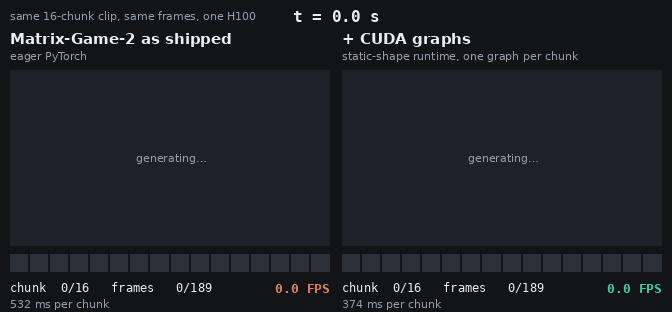
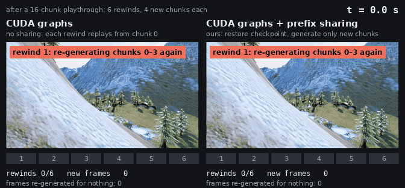

# Datacenter GPUs (H100 / L40S)

fastworld started as an exact runtime for datacenter GPUs; the repository now targets Jetson (see the
[README](../README.md) and [jetson.md](jetson.md)). Everything below was measured on one H100 80GB and still applies there:
the exact runtimes are platform-independent, only the environment differs (torch 2.7.1+cu126, prebuilt flash-attn
2.8.3, see [setup.md](setup.md#datacenter-gpus)).

  

*Same 16-chunk clip, same frames, one H100. Matrix-Game-2 as shipped (eager PyTorch) finishes in 8.5 s at 22 FPS;
the CUDA-graph runtime finishes the identical clip in 6.0 s at 31.6 FPS.*

  

*Both sides use CUDA graphs. After a 16-chunk playthrough the player rewinds six times and plays four new chunks each
time. Without sharing, each rewind replays the whole prefix (207 frames re-generated for nothing in 10 s); with the
prefix cache a rewind is a checkpoint restore and only the new chunks are generated.*

## Matrix-Game-2 on H100

| Matrix-Game-2, one H100, 352x640, 12 frames per chunk | explore (8 players, shared start) | rewind (6 rewinds) | time to first new frame after a rewind | frames identical |
|---|---|---|---|---|
| Matrix-Game-2 as shipped (eager DiT + Wan VAE) | 22.4 FPS | 22.2 FPS | 5.3 s | reference |
| + CUDA-graph DiT (`StaticMG`) | 31.3 FPS (1.40x) | 31.5 FPS (1.42x) | 5.3 s | yes |
| + exact prefix cache (`PrefixCache`, checkpoint every 2 chunks) | **66.3 FPS (2.96x)** | **73.0 FPS (3.29x)** | **0.38 s** | **yes** |
| same, with the lossy TAEHV decoder instead of the Wan VAE | 105 FPS (4.7x) | 117 FPS (5.3x) | 0.24 s | no (PSNR 24.7 dB vs Wan VAE) |

Per chunk the DiT goes from 369 ms to 229 ms (1.61x; the GPU is then 99 % busy), the session state shrinks from 1.51 GiB
to 0.60 GiB, state save/restore takes 0.8 ms, and all 60 benchmark requests in every exact mode hash to the same frames
as the official pipeline. Numbers: `results/mg2/*.json`; how they were measured: `scripts/mg2/run_bench.py`.

## Why not just `torch.compile`?

We tried the built-in options on the unmodified Matrix-Game-2 forward (`scripts/mg2/compile_baselines.py`, H100):

| | warm chunk | speedup | bitwise | notes |
|---|---|---|---|---|
| eager (as shipped) | 375 ms | 1.00x | reference | ~3,600 kernel launches and ~1,400 host syncs per forward, GPU 62 % busy |
| `torch.cuda.graph()` around a chunk | fails | | | the official loop creates RNG generators and does `.item()` during capture |
| `torch.compile(model)` | 335 ms | 1.12x | no (max diff 4.3) | 65 graph breaks, 77 s compile |
| `mode="max-autotune-no-cudagraphs"` (the Self-Forcing recommendation) | 397 ms | 0.96x | no | 18 min compile |
| `mode="reduce-overhead"` (Inductor + CUDA-graph trees) | 349 ms | 1.06x | no | ~40 cudagraph skips (mutated KV-cache inputs, CPU-side grid sizes), 12 min compile |
| **fastworld `StaticMG`** | **229 ms** | **1.60x** | **yes** | 2 s capture, 0 graph breaks |

The compiled variants drift because Inductor fuses and reorders the floating-point work, and the drift compounds
through the KV cache. fastworld changes no kernels: it only removes the host-side work between them, so the graphs
replay exactly what eager computed.

## Does it help other models?

The same runtime was built for three more released world models, with the same exactness checks (official loop
vs ours, with and without graphs, plus save/branch/restore, all bitwise on H100). The gain depends on how
launch-bound the official code is:

| model | setting | official loop, GPU busy | fastworld (bitwise) | `torch.compile` (not bitwise) | doc |
|---|---|---|---|---|---|
| Matrix-Game-2 1.3B | 352x640, 3 steps | 62 % | **1.61x** DiT, 2.96-3.29x served with sharing | 1.12x | [docs/models/mg2.md](models/mg2.md) |
| LingBot-World-v2 1.3B causal-fast | 480x832, 4 steps | 94 % | 1.16x (975 -> 843 ms/chunk) | 1.20x, drift up to 3.7 | [docs/models/lingbot_v2.md](models/lingbot_v2.md) |
| Matrix-Game-3.0 5B distilled | 704x1280, 3 steps, INT8 + FA3 | 98 % | 1.12x (2800 -> 2509 ms/iter) | 1.34x, cos 0.78 by iter 7 | [docs/models/mg3.md](models/mg3.md) |
| LongLive-2.0 5B | 704x1280, 4 UniPC steps | 97.5 % | 1.04x (1758 -> 1688 ms/chunk) | recompiles every chunk, no faster | [docs/models/longlive2.md](models/longlive2.md) |

CUDA graphs pay off when the GPU is idle between launches (Matrix-Game-2). On the compute-bound models the gain comes
from the redundant work the static rewrite exposes: whole-cache clones per forward, cross-attention and camera
features recomputed every denoising step, fp64 RoPE tables rebuilt per call. `torch.compile` is faster there because
it fuses the remaining fp32 elementwise work, at the price of exactness; nothing stops you from compiling the static
forward if you can accept that. What every port gives regardless of speed is an exact, sync-free session engine with
state you can save, restore and branch.
