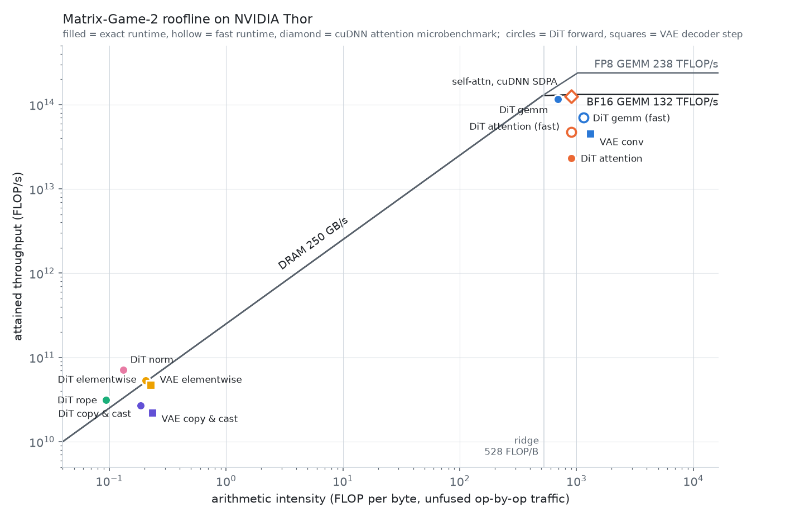
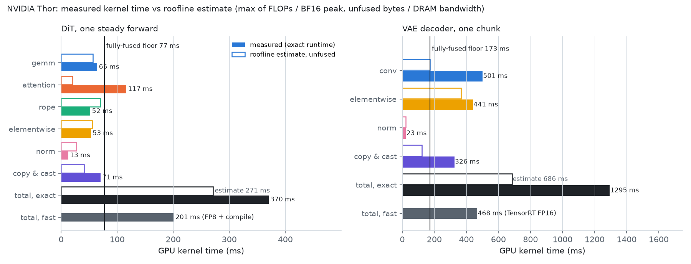

# Matrix-Game-2 on Jetson AGX Thor

Measured on a Jetson AGX Thor developer kit (L4T R38.4, CUDA 13.0, MAXN, GPU at its max clock of 1575 MHz),
torch 2.14.1+cu130, flash-attn 2.8.3 built for sm_110, TensorRT 10.13.3. Raw numbers: `results/mg2/thor/*.json`.
Setup: `scripts/jetson/setup.sh`, then `scripts/jetson/build_flash_attn.sh`.

## Device

Measured ceilings (from a separate roofline study on the same board): **136 TFLOP/s** BF16 GEMM, **253 GB/s** DRAM
(LPDDR5X, 273 GB/s theoretical). On MG2's shapes FP8 GEMMs (`torch._scaled_mm`, row-wise scales) reach 183-239 TFLOP/s:

| GEMM (M=2640 tokens) | BF16 | FP8 | speed-up |
|---|---|---|---|
| 1536 -> 1536 (attention projections) | 0.099 ms, 126 TF | 0.052 ms, 239 TF | 1.89x |
| 1536 -> 8960 (FFN up) | 0.714 ms, 102 TF | 0.397 ms, 183 TF | 1.80x |
| 8960 -> 1536 (FFN down) | 1.433 ms, 51 TF | 0.357 ms, 203 TF | 4.01x |

The ridge point is ~537 FLOP/byte (an H100's is ~300): any kernel below that is bandwidth-bound, which covers every
unfused elementwise op, layout conversion and fp64 temporary in MG2. That is where most of the time goes (below).

## The exact runtime works, unchanged

`scripts/mg2/test_static.py --chunks 10`: eager, static and CUDA-graph outputs are bitwise identical on all 20 chunks
(2 images x 10), branch/restore bitwise on all 5 checks, session state 0.60 GiB (eager 1.51 GiB).
`scripts/mg2/run_bench.py --smoke` (`results/mg2/thor/bench_smoke.json`): every request in all 7 modes matches its
reference hash.

| per chunk (12 frames) | Thor | H100 |
|---|---|---|
| DiT eager | 2638 ms | 369 ms |
| DiT CUDA graph | 2096 ms (1.26x) | 229 ms (1.61x) |
| prefill (one context forward) | 594 ms | 58 ms |
| Wan VAE decode | 1777 ms (graph: no gain) | 153 ms |
| TAEHV decode | 70 ms | 10 ms |

CUDA graphs help less than on an H100 because Thor is busy computing for 98 % of a graph replay: the problem is the
kernels, not the launches.

## Where the time goes

`torch.profiler`, one steady chunk without graphs:

- **DiT** (1650 ms of kernels): GEMMs 23 %, flash-attention 28 %, elementwise glue ~50 % (residual adds, modulation,
  casts, `cat`, norms). Two specific wastes:
  - the action module's attentions (query length 3, key length <= 6, batch 880) go through flash-attn, whose 128-row
    tiles are ~97 % padding at that shape: 239 ms for the hdim-64 mouse attention alone;
  - RoPE is applied in **float64 complex** (as the official `wan` code does, and as exactness requires): ~150 ms
    including the dtype conversions, memory-bound on LPDDR.
- **Wan VAE** (1428 ms of kernels): the 3D convolutions are only ~25 %. NCHW<->NHWC conversions around every cuDNN
  conv take 260 ms, the causal-padding `cat` copies 280 ms, the rest is RMS-norm / SiLU elementwise work.

## Fast paths (approximate)

Both live next to the exact runtime and keep its interface, so `PrefixCache` and the benchmarks take them as is.

### `TRTVAE` (`fastworld/models/mg2/trt_vae.py`): TensorRT FP16 decoder

The steady-state decoder step (latent chunk + the 32-tensor causal feature cache in, 12 frames + the next cache out) is
exported to ONNX and built into a static-shape FP16 engine (`python -m fastworld.models.mg2.trt_vae`, ~15 min). Chunk 0
(empty cache) runs the eager decoder; the cache then lives in two static buffer sets used alternately, so a step is one
`execute_async_v3` with no copies. State save/restore = the active buffer set.

`scripts/mg2/thor_vae.py` (real latents, 12 chunks, vs the exact eager decoder):

| decoder | ms / chunk | PSNR vs exact | 8-bit pixels that differ |
|---|---|---|---|
| Wan VAE, eager / CUDA graph | 1270 / 1269 | exact | 0 |
| **TensorRT FP16** | **465 (2.73x)** | **65.0-67.4 dB, every chunk** | 7-9 % (off by one level) |
| TAEHV | 53 (24x) | 21-23 dB | 95 % |

Gotcha: three of the eager decoder's cache tensors (the first cache after each spatial upsample) come out with permuted
strides. TensorRT reads and writes dense NCDHW bytes, so the engine's buffers must be allocated contiguous
(`torch.empty(shape)`, not `empty_like`); with `empty_like` engine->engine steps are fine but the eager->engine
handover after chunk 0 is scrambled (one 33 dB chunk). Forcing the norms to FP32 is available (`build(norm_fp32=True)`)
but measured +2 % time for a 78 dB difference, so it is off.

Channels-last 3D weights alone (no TensorRT) give 1423 -> 1176 ms with a max error of 0.003; TensorRT subsumes it.

### `FastMG` (`fastworld/models/mg2/fast.py`): fused / FP8 DiT

A `StaticMG` subclass; every trick is a flag. `scripts/mg2/thor_fast.py` (12 chunks):

| variant | ms / chunk | vs exact |
|---|---|---|
| exact `StaticMG` (graph) | 1442 | 1.00x |
| `rope32` (fp32 real RoPE) | 1509 | 0.96x |
| `small_attn` (fp32 einsum for the action attentions, no K/V repeat) | 1358 | 1.06x |
| both | 1424 | 1.01x |
| both + `compile` (Inductor over the whole forward, then our CUDA graph) | 901 | **1.60x** |
| + `fp8` (self-attn q/k/v/o, cross-attn q/o, FFN as row-wise FP8 GEMMs) | 793 | **2.02x** (exact: 1604 ms in that run) |

Without fusion the replacements do not pay: each fp32 temporary is another DRAM round trip. Inductor fuses them and
the elementwise glue around them. First compile takes 11-13 min on Thor (cached on disk afterwards); the CUDA graph is
captured around the compiled code exactly as for the exact runtime. (The exact baseline varied between 1442 and
1604 ms across runs; the ratios above are within one run. The variance is one unstable BF16 GEMM, see the roofline
section.)

**These are not exact, and on an autoregressive world model "approximate" means "a different rollout".** The first chunk
is at 31-39 dB vs the exact runtime, but the error feeds back through the KV history, and after a few chunks the video is
a different (plausible) continuation: PSNR vs exact falls to 11-15 dB by chunk 12 for every variant, including the
cheapest one. PSNR against the exact rollout therefore measures divergence, not quality; judge the output by eye
(`results/mg2/thor/side_by_side_exact_vs_fast.mp4`, written by `thor_e2e.py`) or with a perceptual / FVD-style metric.
The decoder is different: it has no feedback, so `TRTVAE` stays at 65 dB indefinitely.

## End to end

`scripts/mg2/thor_e2e.py`, image 0000, 16-chunk playthrough and the rewind workload (one playthrough + 6 rewinds, served
through `PrefixCache` with a checkpoint every 2 chunks):

| config | playthrough | rewind workload | first new frame after a rewind |
|---|---|---|---|
| exact: `StaticMG` + Wan VAE (graph) | 4.4 FPS (2687 ms/chunk) | 10.1 FPS | 2.73 s |
| `FastMG` (fp8 + compile) + `TRTVAE` | **8.6 FPS** (1369 ms/chunk) | **22.2 FPS** | **1.23 s** |
| `FastMG` (fp8 + compile) + TAEHV | 14.8 FPS (800 ms/chunk) | 34.0 FPS | 0.82 s |

## Roofline

`scripts/mg2/roofline.py census roofs attn time plot` (needs an idle GPU; ~15 min). Raw data:
`results/mg2/thor/roofline.json`. Plots: `roofline.png`, `roofline_time.png`.

**Method.** FLOPs and bytes come from an ATen-level dispatch census of the exact runtime: one steady DiT forward and one
VAE decoder step. Every op is charged its distinct input + output tensor bytes, and views are free. That is the traffic
of running the ops one at a time (*unfused*). It is an estimate, not a floor: small tensors that stay in L2 make RoPE,
norm and the VAE copies run *faster* than it. Kernel times come from `torch.profiler`. The roofs were measured on the
same idle board: **BF16 GEMM 132 TFLOP/s, FP8 GEMM 238 TFLOP/s, DRAM 250 GB/s, ridge 528 FLOP/B**. These agree with
an independent roofline study on this board (136 TFLOP/s, 253 GB/s).

**Work per chunk** (3 denoising forwards + 1 context forward + 1 decoder step):

| | FLOPs | unfused traffic |
|---|---|---|
| DiT GEMMs | 30.0 TFLOP | 44 GB |
| DiT attention | 10.8 TFLOP | 12 GB |
| VAE convolutions | 22.8 TFLOP | 17 GB |
| everything else (RoPE, casts, norms, modulation, cat, residuals, SiLU) | 0.05 TFLOP | **325 GB** |

82 % of the traffic is glue around the three math-heavy op types, at 0.1-0.3 FLOP/B, ~2,000x below the ridge. Those
ops can only be bandwidth-bound, and the only way to make them cheaper is not to run them as separate kernels.

### DiT, one steady forward (exact 370 ms, fast 201 ms, floor 52-77 ms)

| class | measured | at | what limits it |
|---|---|---|---|
| GEMM | 65 ms | **116 TFLOP/s, 88 % of BF16 peak** | nothing in this run, but see "unstable BF16 GEMM" below: 97 ms in other processes |
| attention | 117 ms | | half of it (60 ms) is the action module's mouse attention: ~0 useful FLOPs in 97 %-padded flash-attn tiles |
| ... main self + cross attention | 57 ms | 47 TFLOP/s, 36 % of peak | **FlashAttention 2** (Ampere-style `mma.sync`, no Blackwell tensor-core path) |
| RoPE (fp64), elementwise, norm, copy & cast | 189 ms | on the DRAM roof | unfused glue: half of the forward |

The fast runtime (`FastMG`, fp8 + compile, 201 ms) removes the glue and the padded mouse attention. Its remaining time:

| | ms | note |
|---|---|---|
| FP8 GEMMs (CUTLASS via `torch._scaled_mm`) | 41 | 6.6 TFLOP at **161 TFLOP/s, 68 % of FP8 peak**, the same in every run |
| FP8 activation quantization (per-token amax + scale, Inductor) | 32-34 | a memory-bound reduction in front of every FP8 linear |
| fp32 SIMT GEMM from `small_attn`'s fp32 einsum | 19-21 | **a bug in the fast path**: the shared-keyboard einsum runs without tensor cores (4x slower than bf16) |
| other BF16 GEMMs (action module, cross K/V) | 12-15 | |
| self + cross attention, FlashAttention 2 | 57 | 47 TFLOP/s |
| fused elementwise (Triton) | 36 | |

Same-process A/B (`results/mg2/thor/fp8_ab.json`, graphs, one process so all three see the same GEMM state):

| | chunk | per-forward GEMM kernels |
|---|---|---|
| exact `StaticMG` | 1598 ms | BF16 98 ms |
| `FastMG` compile | 910 ms | BF16 100 ms + fp32 SIMT 21 ms |
| `FastMG` compile + fp8 | 802 ms | FP8 41 + quantize 34 + BF16 12 ms |

FP8 saves 108 ms per chunk here. Its value depends on the BF16 baseline, though. FP8 matmul plus quantization is
~75 ms per forward. That beats BF16 when BF16 GEMMs take ~98 ms (this run). It is roughly a wash when they take ~65 ms
(the roofline run). Cheaper scaling (item 3 below) makes FP8 a clear win in both cases.

**Unstable BF16 GEMM.** One shape, the FFN down-projection (2640 x 8960 -> 1536), runs at 49-50 TFLOP/s in most
processes but ran at ~110 TFLOP/s in the roofline run (in-model) and 76 TFLOP/s in that run's microbenchmark. It uses
the same cuBLAS kernel name (`nvjet_sm110_tst_192x272_64x3_2x1_v_bz_bias_TNT`) in both cases. Every other BF16 shape,
the FP8 kernels and FlashAttention are stable to a few %. That one GEMM accounts for ~100 ms of the exact runtime's
1442 vs 1604 ms per chunk on different runs (30 calls x 4 forwards x ~0.83 ms). Ruled out: GPU clock (1575 MHz in both), power (86 W
under a square GEMM at 135 TFLOP/s), temperature (< 70 C), bias epilogue, cuBLAS/cuBLASLt workspace size and BLAS
backend. Not tested (needs root): physical-memory fragmentation; the fast run came minutes after another process
released 48 GB of the shared memory. FP8 sidesteps the problem for this layer.

**Attention backends** at MG2's self-attention shape (2640 x 5280, 12 heads, d=128), same inputs:

| backend | TFLOP/s | max diff vs FA2 |
|---|---|---|
| FlashAttention 2.8.3 (built for sm_110) | 48 | - |
| PyTorch flash SDPA | 45 | 0.0005 |
| **cuDNN SDPA** | **126 (2.6x)** | 0.001 |
| memory-efficient SDPA | 18 | 0.001 |

cuDNN's attention reaches 95 % of the BF16 GEMM roof on Thor. Switching MG2's self- and cross-attention to it would take
57 ms down to ~21 ms per forward. The FA2 result is the main thing the roofline exposed: attention is not hard on this
chip, the library is the limit.

### VAE decoder, one chunk (exact 1295 ms, TensorRT 468 ms, floor 173 ms)

| class | exact | TensorRT | note |
|---|---|---|---|
| convolution math | 316 ms (78 TFLOP/s) | 223 ms (103 TFLOP/s, 78 %) | the VAE is compute-bound once fused: 22.8 TFLOP / 132 = 173 ms |
| cuDNN NCHW <-> NHWC transposes | 185 ms | 0 | TensorRT keeps one layout |
| elementwise / copy & cast / norm | 790 ms | 180 ms (fused) + 9 ms memcpy | TensorRT fuses norm + SiLU + cat around each conv |

### Per chunk

| | kernel time | FPS (12 frames) |
|---|---|---|
| exact runtime | 2775 ms | 4.3 |
| fast runtime (`FastMG` + `TRTVAE`) | 1272 ms | 9.4 |
| **floor, everything fused, BF16** | 481 ms | 25 |
| **floor, everything fused, FP8 DiT GEMMs** | 380 ms | 32 |

(End to end, with host work and the prefix cache, the measured rates are 4.4 and 8.6 FPS; see above.)

The fast runtime is at 30-38 % of the floor. In order of payoff, the gap closes with:

1. **cuDNN attention instead of FlashAttention 2**: -36 ms per forward, -144 ms per chunk. Not exact, so it belongs in
   `FastMG`; for the exact runtime it would be a different reference.
2. **Fix the fp32 einsum** in `FastMG(small_attn=True)` (bf16 inputs, fp32 softmax): -15 ms/forward.
3. **Cheaper FP8 activation scaling**: per-tensor delayed scales, or fusing the amax into the producer's epilogue,
   instead of a separate per-token reduction: up to -30 ms/forward.
4. **VAE glue into conv prologues/epilogues** (TensorRT plugins or a hand-fused decoder): the remaining ~190 ms of
   TensorRT elementwise time is mostly norm + SiLU before each conv.

With 1-3, the DiT would be at ~120 ms/forward and a chunk at ~950 ms (~13 FPS). That is still 2.5x from the floor, but
without a new model or a lossier decoder. For the exact runtime, which has to stay in BF16, the FFN down-projection is
the one GEMM to pin down: in its slow state it alone costs ~45 ms per forward.

## Environment gotchas

- **FlashAttention**: no aarch64/sm_110 wheel. v2.8.3 needs the `compute_110` gencode added and `-std=c++20` (torch 2.14
  headers); `scripts/jetson/build_flash_attn.sh` applies both. ~2 h build.
- **TensorRT**: JetPack ships the Python bindings (`python3-libnvinfer`) for the system Python only; `setup.sh` symlinks
  them into the venv (same Python 3.12 ABI).
- **Weights**: the HF repo is 21.5 GB but MG2 needs 11.8 GB (`base_distilled_model`, VAE, CLIP, tokenizer).
- **torchvision 0.29** has no `torchvision.io.write_video`; videos go through `fastworld.write_mp4` (imageio-ffmpeg).
- The official `requirements.txt` lists `nvidia-tensorrt`, `pycuda`, `onnxruntime`, `wandb`, `flask`...: none are used by
  inference; `setup.sh` installs only what the pipeline imports.

## Next

- The roofline above ranks the remaining DiT work: cuDNN attention, the fp32-einsum fix and cheaper FP8 scaling.
  A TensorRT engine for the whole DiT (history buffers as engine I/O, like the VAE cache) is the larger alternative.
- A decoder between TensorRT-Wan (465 ms, 65 dB) and TAEHV (53 ms, 22 dB), e.g. TAEHV fine-tuned on MG2 latents or an
  INT8 TensorRT Wan decoder.
- Other models in `fastworld/models/` (LingBot-World-v2, Matrix-Game-3, LongLive-2) were ported and validated on H100
  only. Matrix-Game-3 uses FlashAttention 3, which has no sm_110 build here, so it needs a different attention path on Thor.
